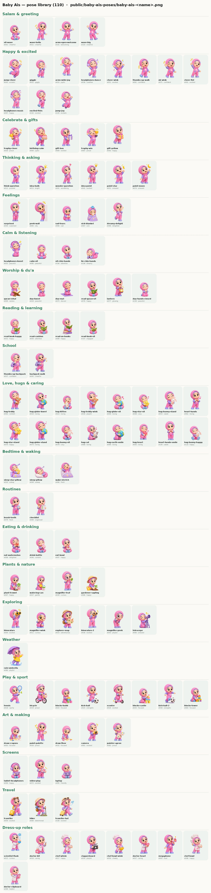

# Baby Ais — pose library

110 renders of Baby Ais, cut from the 11 character sheets, named and annotated so picture books can pick the pose that fits each moment.



## Files

- Images: `public/baby-ais-poses/baby-ais-<name>.png` — 800×800 transparent PNG, same scale and ground line as Baby Mo (feet at y=725). Sitting/kneeling poses are scaled so her head matches the standing poses.
- Catalogue for code: `lib/cerita/ais-poses.ts` — `AIS_POSES` (name, category, mood, props, use), `AIS_FOR` (quick picks per story moment), `AIS_GAPS`.
- Reference sheet: `docs/baby-ais-pose-library.jpg` (grouped by category).

## Using her in a scene

```ts
mo: [
  { pose: "pose-25", x: 330 },                 // Baby Mo
  { who: "ais", pose: "wave-hello", x: 470 },  // Baby Ais
]
```

- `who: "ais"` switches to the Ais renders; everything else (`x`, `s`, `flip`, `move`) works like Baby Mo.
- `move: "hop"` suits `jump-cheer`, `jump-joy`, `excited-fists`; `move: "still"` suits sleeping, du'a and calm poses.
- Many poses already hold a prop (teddy, kitten, globe, Qur'an on rehal, gift…). Don't add the same prop again in the scene — check `props` in the catalogue.
- `flip: true` mirrors her to face the other twin (she mostly faces right). Avoid flipping poses with writing/symbols that would read backwards (clapperboard, video-play, books).
- In twin scenes keep 120–160 px between them so they don't overlap; put the one who speaks on that page closer to the middle.

## Moment → pose (quick finder)

| Story moment | Best Ais pose | Also |
|---|---|---|
| Saying salam / hello | `wave-hello` | wave-big, sit-wave, arms-open-welcome |
| Goodbye, setting off | `backpack-walk` | wave-big, thumbs-up-walk |
| Happy | `arms-wide-joy` | giggle, cheer-wink, ok-wink |
| Big celebration | `jump-cheer` | jump-joy, trophy-cheer, excited-fists |
| Asking a question (Apa itu / Kenapa) | `think-question` | wonder-question |
| Getting an idea | `idea-bulb` | idea-point |
| Surprised / shocked | `surprised` | dreamy-delight |
| Awe at creation, night sky | `point-moon` | point-star, telescope, dreamy-delight |
| Sad, lost something | `sad-tears` | hug-bunny-sit, hug-star-sit |
| Sick | `sick-blanket` | — |
| Shy / hiding / peeking | `peek-wall` | — |
| Calming down, deep breath | `calm-sit` | headphones-kneel |
| Listening to a story | `sit-chin-hands` | read-cushion, lie-chin-hands |
| Du'a | `dua-mat` | dua-kneel, dua-hands-closed |
| Saying thank you / sorry | `dua-hands-closed` | heart-hands, hug-heart |
| Reading Qur'an | `quran-rehal` | read-quran-sit |
| Ramadan night | `lantern` | point-moon, eat-watermelon (iftar) |
| Love / kindness | `heart-hands` | hug-heart, heart-hands-smile |
| Comfort toy | `hug-teddy` | hug-bunny-stand, hug-star-stand |
| Kind to animals | `hug-kitten` | hug-cat |
| Allah's creation / environment | `hug-earth-smile` | hug-globe-sit, magnifier-leaf |
| Going to sleep | `sleep-pillow` | sleep-star-pillow |
| Waking up | `wake-stretch` | — |
| Brushing teeth / routine | `brush-teeth` | checklist |
| Eating | `eat-bowl` | eat-watermelon, drink-bottle |
| Planting / watering | `watering-can` | plant-trowel, gardener-sapling |
| Rain | `rain-umbrella` | — |
| Searching for something | `magnifier-peek` | magnifier-wink, binoculars |
| Building / not giving up | `blocks-tower` | blocks-castle, blocks-build |
| Drawing a card | `draw-crayons` | draw-floor, paint-palette |
| School / new class | `thumbs-up-backpack` | backpack-walk |
| Playing outside | `kick-ball` | bicycle, scooter, tennis |
| Gifts, birthday, Eid | `gift-box` | gift-yellow, birthday-cake |
| Baking with Umi | `chef-whisk` | chef-bowl, chef-bowl-wink |
| Caring for the sick | `doctor-kit` | doctor-heart |
| Trips / Nenek's house | `traveller` | traveller-hat, explorer-map, hiker |
| Screens, video call | `laptop` | tablet-headphones, video-play |

## Pairing with Baby Mo

Use the matching emotion for both twins on shared pages, or contrast them when the story is about one feeling the other:

| Feeling | Baby Mo | Baby Ais |
|---|---|---|
| Hello | `pose-01` | `wave-hello` |
| Joy | `yeyy` | `jump-cheer` |
| Arms wide | `pose-41` | `arms-open-welcome` |
| Thinking | `pose-33` | `think-question` |
| Idea | `idea` | `idea-bulb` |
| Surprised | `pose-40` / `pose-26` | `surprised` |
| Sad | `pose-37` | `sad-tears` |
| Calm / eyes closed | `pose-07` | `calm-sit` |
| Sitting | `pose-12` | `sit-chin-hands` |
| Du'a | `pose-07` | `dua-kneel` |
| Thank you | `thank-you` | `heart-hands` |
| Thumbs up | `pose-25` / `pose-29` | `thumbs-up-walk` |
| Asleep | `pose-39` | `sleep-pillow` |

## Gaps (no Ais render yet)

Use Baby Mo for these, change the scene, or brief new Ais art:

- sujud (prostration) — show her on the mat with `dua-mat` instead
- angry / grumpy / tantrum
- crying hard, or lying down upset
- running fast (she only walks)
- scared / hiding face
- shrug / "I don't know"
- pointing sideways or down (she only points up)
- sitting at a table with family

## All poses

Notes say what she is doing and which story moments the pose fits. *alt* = near-duplicate, kept so two neighbouring pages don't repeat the same image.

### Salam & greeting

| # | Name | Mood | Props | Notes / use |
|---|---|---|---|---|
| 001 | `sit-wave` | cheerful | — | Sitting cross-legged, waving. Hello on a calm page, saying salam from the floor, start of a story. |
| 021 | `wave-hello` | cheerful | — | Standing, waving. Default friendly Ais; greeting, saying bye, welcoming someone. |
| 101 | `arms-open-welcome` | welcoming | — | Arms open wide. Welcome, 'come here!', reunion hug, 'all of this!'. |
| 103 | `wave-big` | cheerful | — | Big wave. Calling someone, 'Assalamu'alaikum!', bye. |

### Happy & excited

| # | Name | Mood | Props | Notes / use |
|---|---|---|---|---|
| 005 | `jump-cheer` | ecstatic | — | Mid-air jump, fists up, eyes closed laughing. Big win, surprise reveal, reunion. Use move:'hop'. |
| 022 | `giggle` | giggly | — | Standing, hands over mouth, giggling. Laughing at something funny, keeping a secret. |
| 033 | `arms-wide-joy` | joyful | — | Standing, arms wide, eyes closed laughing. Pure happiness, 'Alhamdulillah!', big hug coming. |
| 038 | `headphones-dance` | carefree | headphones, music notes | Dancing with headphones. Songs, nasheed, happy music moment. |
| 051 | `cheer-wink` | excited | sparkles | Fist up with wink and confetti. 'Yeay!', small win. |
| 061 | `thumbs-up-walk` | confident | — | Walking with thumbs up and wink. 'Good job!', agreement, heading off happily. |
| 071 | `ok-wink` | confident | — | OK sign with wink. 'All good!', agreement. |
| 091 | `cheer-fist` | excited | sparkles | Fist up, wink. 'Yes!' moment (alt to 051). |
| 097 | `headphones-music` | happy | headphones, notes | Standing with headphones and music. Songs, nasheed. |
| 102 | `excited-fists` | excited | — | Fists clenched at chest, eyes closed, kick. Can't wait, excitement building. |
| 105 | `jump-joy` | ecstatic | — | Jumping with arms up. Celebration, 'hooray!'. Use move:'hop'. |

### Celebrate & gifts

| # | Name | Mood | Props | Notes / use |
|---|---|---|---|---|
| 030 | `trophy-cheer` | proud | trophy | Holding a trophy, fist up. Winning, achieving a goal (also a good 'well done' page). |
| 064 | `birthday-cake` | joyful | cake | Carrying a cake with candles. Surprises, celebrations, baking result. |
| 069 | `gift-box` | excited | gift | Holding a wrapped gift. Giving/receiving presents, Eid, surprises. |
| 087 | `trophy-win` | proud | trophy | Lifting trophy, fist up. Winning (alt to 030). |
| 092 | `gift-yellow` | happy | yellow gift | Holding a yellow present. Giving gifts, sharing. |

### Thinking & asking

| # | Name | Mood | Props | Notes / use |
|---|---|---|---|---|
| 012 | `think-question` | puzzled | question mark | Standing, finger on chin, '?' above. Asking a question (all 'Apa itu / Kenapa' stories). |
| 013 | `idea-bulb` | bright | light bulb | Standing, pointing up, light bulb. Getting an idea, figuring it out, 'aha!' page. |
| 041 | `wonder-question` | wondering | question mark | Looking up, finger on chin, '?'. A softer 'I wonder…' question (faith-question stories). |
| 042 | `idea-point` | excited | light bulb | Pointing up with a bulb. 'I know!' — use after 041 on the next page. |
| 052 | `point-star` | amazed | star | Pointing up at a star. Stars, night sky, 'look up there!'. |
| 074 | `point-moon` | amazed | moon & star | Pointing up at a crescent moon. Ramadan moon, night sky, Hijri months. |

### Feelings (surprise, sad, sick, shy)

| # | Name | Mood | Props | Notes / use |
|---|---|---|---|---|
| 044 | `surprised` | surprised | exclamation | Hands on cheeks, 'oh!' mouth. Shock, discovery, 'something happened!' (thunder, broken glass). |
| 065 | `peek-wall` | shy | wall edge | Peeking from behind a wall. Hide-and-seek, shy, curious peek, surprise. |
| 066 | `sad-tears` | sad | tears | Kneeling, crying, worried face. Sad, hurt, lost something, missed someone. |
| 067 | `sick-blanket` | sick | blanket, ice pack, tissue | Wrapped in blanket with ice pack and tissue. Being ill, needing care, du'a for the sick. |
| 096 | `dreamy-delight` | delighted | sparkles | Hands on cheeks, sparkly eyes. Delighted, in awe, 'so pretty!'. |

### Calm & listening

| # | Name | Mood | Props | Notes / use |
|---|---|---|---|---|
| 055 | `headphones-kneel` | peaceful | headphones, notes | Kneeling with headphones, eyes closed. Listening to Qur'an recitation/nasheed calmly. |
| 085 | `calm-sit` | peaceful | — | Sitting cross-legged, eyes closed, hands resting. Calming down, deep breath, dhikr, quiet. |
| 106 | `sit-chin-hands` | attentive | — | Sitting, chin in hands, smiling. Listening to a story, waiting patiently, daydreaming. |
| 108 | `lie-chin-hands` | dreamy | — | Lying on tummy, chin in hands. Daydreaming, listening, lazy afternoon. Wide pose. |

### Worship & du'a

| # | Name | Mood | Props | Notes / use |
|---|---|---|---|---|
| 009 | `quran-rehal` | serene | Qur'an on rehal | Kneeling, eyes closed, Qur'an on a wooden stand. Reading/reciting Qur'an, tilawah, Ramadan. |
| 029 | `dua-kneel` | peaceful | — | Kneeling, eyes closed, hands together. Quiet du'a, being thankful, pleading softly, forgiving. |
| 075 | `dua-mat` | devout | prayer mat | Kneeling on a prayer mat, hands raised in du'a, eyes closed. Prayer, du'a after sholat. |
| 076 | `read-quran-sit` | happy | Qur'an/Islamic book | Sitting, reading a book with a mosque cover. Reading Qur'an/iqra, learning. |
| 077 | `lantern` | glowing | lantern | Holding a glowing lantern. Ramadan nights, Eid, night walk, light. |
| 109 | `dua-hands-closed` | peaceful | — | Kneeling, palms together, eyes closed. Du'a, gratitude, saying sorry (alt to 029). |

### Reading & learning

| # | Name | Mood | Props | Notes / use |
|---|---|---|---|---|
| 031 | `read-book-happy` | happy | book (mosque cover) | Sitting, reading an Islamic book, eyes closed smile. Story time, learning, Qur'an class. |
| 050 | `read-cushion` | attentive | book, cushion | Sitting on a cushion reading. Story time, listening to Umi, learning. |
| 089 | `read-on-books` | happy | stack of books | Sitting on a stack of books, reading. Loves learning, library, knowledge. |
| 107 | `read-book-sit` | engaged | book | Sitting, reading a book, smiling. Reading, learning (alt to 031/076). |

### School

| # | Name | Mood | Props | Notes / use |
|---|---|---|---|---|
| 037 | `thumbs-up-backpack` | confident | backpack | Backpack on, wink and thumbs up. Ready for school, 'I can do it!', new class. |
| 045 | `backpack-walk` | cheerful | backpack | Walking with backpack, waving. Going to school, setting off, saying goodbye. |

### Love, hugs & caring

| # | Name | Mood | Props | Notes / use |
|---|---|---|---|---|
| 002 | `hug-teddy` | content | teddy | Standing, eyes closed, hugging a teddy. Comfort, missing someone, bedtime, feeling safe. |
| 010 | `hug-globe-kneel` | loving | globe, hearts | Kneeling, hugging the Earth with hearts. Caring for the world, all of Allah's creation, environment. |
| 023 | `hug-kitten` | loving | kitten | Sitting, hugging a white kitten. Kindness to animals (Kucing di Bawah Hujan). |
| 034 | `hug-teddy-wink` | playful | teddy, heart | Standing, hugging teddy with a wink and heart. Sharing/lending a toy, cosy love. |
| 040 | `hug-globe-sit` | loving | globe, hearts | Sitting, hugging the Earth, eyes closed. Love for creation, gratitude, quiet ending page. |
| 048 | `hug-star-sit` | cosy | star plush, hearts | Sitting, hugging star plush. Comfort, calming down after tears, bedtime. |
| 053 | `hug-bunny-stand` | sweet | bunny plush | Standing, hugging a bunny. Mr Ears (Pak Telinga) is found! Comfort toy. |
| 062 | `heart-hands` | loving | heart | Making a heart with her hands. 'I love you', thanks to Umi/Abi, sweet ending. |
| 070 | `hug-star-stand` | happy | star plush, hearts | Standing, hugging a star. Gratitude 'stars', bedtime, cosy. |
| 073 | `hug-globe-stand` | loving | globe | Standing, hugging the Earth. Creation, love the world. |
| 078 | `hug-bunny-sit` | cosy | bunny plush | Sitting, hugging bunny, eyes closed. Comfort, bedtime, missing someone. |
| 088 | `hug-cat` | loving | grey cat, hearts | Kneeling, hugging a grey cat. Pets, kindness to animals. |
| 090 | `hug-earth-smile` | loving | smiling Earth, hearts | Kneeling, hugging a smiling Earth. Environment, litter-picking, creation. |
| 093 | `hug-heart` | loving | big heart | Kneeling, hugging a big heart. Love, kindness, forgiveness, 'pelukan'. |
| 104 | `heart-hands-smile` | sweet | — | Heart hands with gentle smile. Thank you, love, kind words. |
| 110 | `hug-bunny-happy` | happy | bunny plush | Sitting, hugging bunny, eyes closed smile. Toy found, comfort, bedtime. |

### Bedtime & waking

| # | Name | Mood | Props | Notes / use |
|---|---|---|---|---|
| 020 | `sleep-star-pillow` | asleep | star plush, moon pillow, zzz | Asleep hugging a star on a moon pillow. End-of-story bedtime, 'zzz' pages. Use move:'still'. |
| 049 | `sleep-pillow` | asleep | pillow, zzz | Lying asleep on a pillow. Night pages, 'tidur' scenes. Lying pose: give it a wider scene. |
| 068 | `wake-stretch` | fresh | bed, pillow, blanket | Waking up in bed, stretching. Morning, 'Alhamdulillah' wake-up du'a. |

### Routines

| # | Name | Mood | Props | Notes / use |
|---|---|---|---|---|
| 079 | `brush-teeth` | fresh | toothbrush, cup | Brushing teeth with a cup. Morning/bedtime routine, wudu-adjacent cleanliness. |
| 094 | `checklist` | organised | notepad, pencil | Holding a checklist. Plans, routines, holiday jar, to-do, prayer streak. |

### Eating & drinking

| # | Name | Mood | Props | Notes / use |
|---|---|---|---|---|
| 008 | `eat-watermelon` | delighted | watermelon | Sitting, eyes closed, biting watermelon. Enjoying food, breaking the fast, gratitude for food. |
| 046 | `drink-bottle` | content | milk bottle | Sitting, drinking from a bottle, eyes closed. Drinking, breakfast, little-sister moments. |
| 047 | `eat-bowl` | happy | bowl, spoon | Sitting, eating fruit from a bowl. Mealtime, iftar, sharing food. |

### Plants & nature

| # | Name | Mood | Props | Notes / use |
|---|---|---|---|---|
| 007 | `plant-trowel` | happy | trowel, potted plant | Kneeling, digging with a trowel next to a potted plant. Planting a seed, gardening. |
| 027 | `watering-can` | gentle | watering can, plant | Kneeling, watering a small plant. Caring for plants, patience, growth stories. |
| 039 | `magnifier-leaf` | curious | magnifier, leaf | Magnifier on a leaf. Studying nature, 'look at Allah's creation closely'. |
| 086 | `gardener-sapling` | happy | straw hat, watering can, sapling | Gardener planting a sapling. Planting trees, patience, sadaqah jariyah. |

### Exploring & discovering

| # | Name | Mood | Props | Notes / use |
|---|---|---|---|---|
| 004 | `binoculars` | excited | binoculars | Standing with binoculars. Spotting games, looking far (Cari Ciptaan Allah, birds, moon). |
| 011 | `magnifier-wink` | curious | magnifying glass | Crouching, magnifier over one eye, wink. Investigating, spot-the-difference, looking closely. |
| 014 | `explorer-map` | adventurous | safari hat, backpack, map | Explorer with hat, backpack and map. Trips, adventures, camping, treasure hunts. |
| 036 | `binoculars-2` | excited | binoculars | Binoculars, upright. Alternate for 004 — use when two spotting pages sit next to each other. |
| 043 | `magnifier-peek` | playful | magnifier | Bending forward with magnifier, wink. Searching for something lost (Pak Telinga). |
| 060 | `telescope` | amazed | telescope | Kneeling at a telescope. Stars, moon, shooting stars, night sky stories. |

### Weather

| # | Name | Mood | Props | Notes / use |
|---|---|---|---|---|
| 080 | `rain-umbrella` | playful | umbrella, raincoat, puddle | Raincoat, umbrella, splashing a puddle. Rain stories, rain du'a, playing in rain. |

### Play & sport

| # | Name | Mood | Props | Notes / use |
|---|---|---|---|---|
| 018 | `tennis` | sporty | racket, ball | Swinging a tennis racket. Sports, Forehand Beat, exercise, 'strong believer'. |
| 019 | `bicycle` | proud | pink bike, helmet | Riding a pink bicycle with helmet. Learning to ride (Sepeda Roda Dua), going out. |
| 024 | `blocks-build` | focused | blocks | Kneeling, building blocks. Playing, building, patience, trying again. |
| 025 | `kick-ball` | energetic | soccer ball | Kicking a football. Park, playtime, running about. |
| 028 | `scooter` | excited | scooter, helmet | Riding a scooter with helmet. Going out, play, speed. |
| 035 | `blocks-castle` | focused | blocks, flag | Kneeling, finishing a block castle. Building together, completing something. |
| 058 | `kick-ball-2` | energetic | soccer ball | Kicking a ball (alt to 025). |
| 083 | `blocks-tower` | focused | blocks | Kneeling, building a tall tower. Building, patience, not giving up. |

### Art & making

| # | Name | Mood | Props | Notes / use |
|---|---|---|---|---|
| 003 | `draw-crayons` | focused | crayons, paper | Kneeling and drawing a sun. Making a card/drawing for someone (Nenek, Umi). |
| 026 | `paint-palette` | proud | brush, palette | Holding paintbrush and palette. Art, making something beautiful, creativity. |
| 032 | `draw-floor` | focused | crayon, paper | Kneeling, drawing on the floor. Making a card or picture, homework. |
| 081 | `camera` | excited | camera | Taking a photo. Capturing a moment, trips, 'look at this!'. |
| 082 | `painter-apron` | proud | apron, brush, palette | Painter in apron. Art projects, making a card. |

### Screens & devices

| # | Name | Mood | Props | Notes / use |
|---|---|---|---|---|
| 006 | `tablet-headphones` | happy | tablet, headphones | Sitting with a tablet and headphones. Screen-time stories (Langit Merah Muda), video calls. |
| 072 | `video-play` | excited | tablet with play button | Pointing at a video. Watching, choosing a video, screen-time stories. |
| 095 | `laptop` | friendly | laptop | Sitting with a laptop, waving. Video call with Nenek, online class. |

### Travel & outdoors

| # | Name | Mood | Props | Notes / use |
|---|---|---|---|---|
| 059 | `traveller` | excited | sunglasses, backpack, suitcase | Pulling a suitcase with sunglasses. Trips, going to Nenek's, holidays (Perjalanan Panjang). |
| 084 | `hiker` | determined | hat, backpack, walking stick | Hiking with stick on a rock. Long walks, effort, adventure. |
| 100 | `traveller-hat` | excited | sun hat, sunglasses, suitcase | Traveller with sun hat and suitcase. Trips, holidays, going away. |

### Dress-up roles

| # | Name | Mood | Props | Notes / use |
|---|---|---|---|---|
| 015 | `scientist-flask` | curious | lab coat, goggles, flask | Scientist with flask. Experiments (the biscuit experiment), wondering how things work. |
| 016 | `doctor-kit` | caring | lab coat, stethoscope, first-aid kit | Doctor with stethoscope and first-aid kit. Playing doctor, caring for a sick Umi/Nenek. |
| 017 | `chef-whisk` | happy | chef hat, apron, whisk, bowl | Chef, eyes closed, whisk and bowl. Baking with Umi, cooking for a neighbour. |
| 054 | `clapperboard` | playful | clapperboard | Holding a film clapperboard. Videos, making a film, 'action!' pages. |
| 056 | `chef-bowl-wink` | cheeky | chef hat, apron, whisk, bowl | Chef with wink. Baking stories (alt to 017/098). |
| 057 | `doctor-heart` | caring | lab coat, stethoscope, heart | Doctor holding a heart. Caring, visiting the sick, 'heart' themes. |
| 063 | `megaphone` | loud | megaphone | Shouting into a megaphone. Announcements, calling everyone, 'Ayo!' |
| 098 | `chef-bowl` | happy | chef hat, apron, whisk, bowl | Chef holding whisk and bowl (alt to 017). |
| 099 | `doctor-clipboard` | helpful | lab coat, stethoscope, clipboard | Doctor with clipboard, pointing up. Explaining, health tips. |
