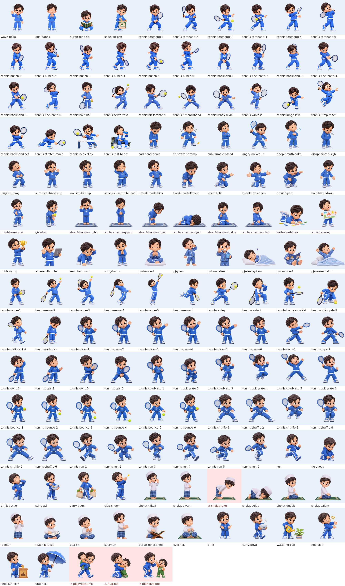
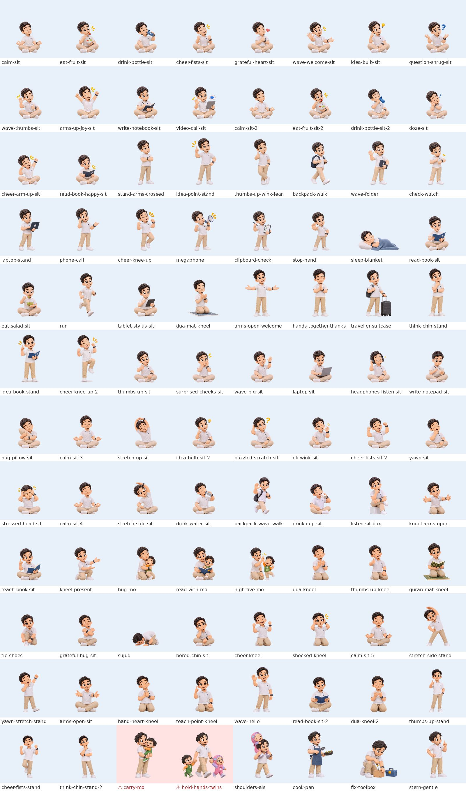

# Baby Mo & friends — pose library (Adam and Ayah)

There are 241 transparent renders. Use them in StoryArt scenes next to Baby Mo and Baby Ais.

| Character | Poses | Files | Reference sheet |
| --- | --- | --- | --- |
| Adam (older brother, about 7) | 145 | `public/adam-poses/adam-<name>.png` | [adam-pose-library.jpg](adam-pose-library.jpg) |
| Ayah (Dad) | 96 | `public/ayah-poses/ayah-<name>.png` | [ayah-pose-library.jpg](ayah-pose-library.jpg) |

The code lives in `lib/cerita/friends-poses.ts`. It holds `ADAM_POSES`, `AYAH_POSES`, the quick picks `ADAM_FOR` and `AYAH_FOR`, and `FRIEND_GAPS`.

## Using them in a scene

```ts
scene: {
  focus: 330,
  mo: [
    { who: "ayah", pose: "kneel-arms-open", x: 300 },
    { pose: "pose-01", x: 420 },
  ],
}
```

- **Size is automatic.** At the same `s`, StoryArt draws Adam 1.4× Baby Mo's height and Ayah 1.9× (`FRIEND_SCALE`). Keep `s` the same for everyone in a scene.
- **Same ground line.** Every PNG is 800×800 with the feet at y = 725, like the Ais renders. Sitting and kneeling poses (marked `low`) are scaled by head size, so they sit at the right height.
- **Ayah fills the page.** He is tall. On a phone page, put him at the edge of the 280-unit visible band and the kids in the middle. Kneeling and sitting poses keep him at the kids' eye level.
- **`duo` poses already include Baby Mo** (`hug-mo`, `read-with-mo`, `high-five-mo`). Don't add a second Mo.
- **`alt` poses are near-duplicates.** Use them so two neighbouring pages don't show the same image.

## How the files were made

- **Adam:** 4 single sheets from the "Kak Ibrahim" Drive folder, plus 5 tennis sheets sent in chat.
- **Ayah:** 30 three-pose sheets from the second Drive folder.
- **Processing:**
  - Each figure was cut out and the background haze removed. One forehand sheet had a grey fog behind it, and that is gone.
  - Scale was evened out by head size, then each figure was placed on the shared ground line.
- **Small losses:** the "zzz" on `ayah-sleep-blanket` was dropped as a stray speck.
- **Wrong outfit:** the tennis sheets show Adam in his blue hoodie, not the tennis outfit from the brief.

## Adam — 145 poses



| Pose | Type | Notes and story use |
| --- | --- | --- |
| `wave-hello` | greet | Standing, one hand up waving, big smile. Arrivals, hello, goodbye. |
| `dua-hands` | worship | Standing, palms cupped in du'a, eyes closed. Before eating, bedtime du'a, thanking Allah. |
| `quran-read-sit` | worship · low | Sitting cross-legged holding an open Qur'an, gentle smile. Reading, Ramadan, teaching the twins. |
| `sedekah-box` | care | Dropping a coin into a "Sedekah" box. Charity, sharing, Friday, Ramadan stories. |
| `tennis-forehand-1` | play | Forehand 1/6: ready stance, racket in front, smiling. Play with ADAM_FOR.forehandFrames; contact is frame 4. |
| `tennis-forehand-2` | play | Forehand 2/6: unit turn: racket up behind his head, free hand pointing at the ball. Play with ADAM_FOR.forehandFrames; contact is frame 4. |
| `tennis-forehand-3` | play | Forehand 3/6: take-back, the ball coming in. Play with ADAM_FOR.forehandFrames; contact is frame 4. |
| `tennis-forehand-4` | play | Forehand 4/6: contact beside his body, ball on the strings. Play with ADAM_FOR.forehandFrames; contact is frame 4. |
| `tennis-forehand-5` | play | Forehand 5/6: follow-through, racket swinging up. Play with ADAM_FOR.forehandFrames; contact is frame 4. |
| `tennis-forehand-6` | play | Forehand 6/6: finish over his shoulder (hug your shoulder), cheering. Play with ADAM_FOR.forehandFrames; contact is frame 4. |
| `tennis-punch-1` | play | Short punch swing 1/6: ready stance. Not a full forehand; use for a block, a low ball or a volley-style return. |
| `tennis-punch-2` | play | Short punch swing 2/6: racket up beside his head. Not a full forehand; use for a block, a low ball or a volley-style return. |
| `tennis-punch-3` | play | Short punch swing 3/6: racket back high, free hand out. Not a full forehand; use for a block, a low ball or a volley-style return. |
| `tennis-punch-4` | play | Short punch swing 4/6: racket dropping low, stepping in. Not a full forehand; use for a block, a low ball or a volley-style return. |
| `tennis-punch-5` | play | Short punch swing 5/6: low contact in front, ball on the strings. Not a full forehand; use for a block, a low ball or a volley-style return. |
| `tennis-punch-6` | play | Short punch swing 6/6: extends forward at chest height (a short, volley-like finish). Not a full forehand; use for a block, a low ball or a volley-style return. |
| `tennis-backhand-1` | play | Two-handed backhand 1/6: ready stance. |
| `tennis-backhand-2` | play | Backhand 2/6: shoulder turn, racket up. |
| `tennis-backhand-3` | play | Backhand 3/6: take-back over the shoulder. |
| `tennis-backhand-4` | play | Backhand 4/6: swing low, stepping in. |
| `tennis-backhand-5` | play | Backhand 5/6: contact, ball on the strings. |
| `tennis-backhand-6` | play | Backhand 6/6: follow-through over the shoulder, laughing. |
| `tennis-hold-ball` | play | Standing relaxed, racket down, ball in hand. Before a match, "want to play?" |
| `tennis-serve-toss` | play | Serve: tossing the ball up, racket back. Start of a game. |
| `tennis-hit-forehand` | play | Hitting a forehand, ball on the racket. Single-image "playing tennis". |
| `tennis-hit-backhand` | play | Two-handed backhand hit, ball arriving. Practice, trying hard. |
| `tennis-ready-wide` | play | Wide ready stance, racket up, cheerful. Waiting for the ball, teaching. |
| `tennis-win-fist` | celebrate | Fist up, eyes closed laughing, racket in hand. Winning a point, "I did it!" |
| `tennis-lunge-low` | play | Low lunge to a ball near the ground. Effort, not giving up. |
| `tennis-jump-reach` | play · air | Jumping with racket and arms out. Big energy, excitement. |
| `tennis-backhand-set` | play | Determined backhand set-up. Concentration, practice. |
| `tennis-stretch-reach` | play · low | Stretching far, racket low to the ball. Trying hard, a near miss. |
| `tennis-net-volley` | play | At the net, volleying. The net is part of the image. |
| `tennis-rest-bench` | routine · low | Resting on a bench, towel round his neck, drinking water. Break time, staying hydrated. |


### Revision batches (November 2026): 48 more

These are from the Adam Pose Revision Brief, batches R1–R4, R7 and R9–R11.

- **Scaled by height, not head size.** These sheets draw Adam with a bigger head, so each sheet is scaled so his standing poses are 640 px tall, matching the first 34 renders.
- **Salat (R4):** drawn in the hoodie, not the peci and koko the brief asked for. `sholat-ruku` has a rounded back and bent knees; use it small, or redo it.
- **Serve frames (R9):** the sheet's number labels and haze were cut away. `tennis-serve-5` (the jump) is about 10% smaller so the racket and ball fit.
- **Racket:** the R9 and R11 tennis poses have a yellow-and-black racket, where the earlier tennis renders have a blue one.
- **Replacements:** `tennis-volley` and `tennis-rest-sit` replace `tennis-net-volley` and `tennis-rest-bench`, which have the net and bench baked in.

| Pose | Type | Notes and story use |
| --- | --- | --- |
| `sad-head-down` | feel | Standing, head down, shoulders drooping. Sad, disappointed, missed a chance. |
| `frustrated-stomp` | feel | Stamping one foot, fists down, steam puffs. Frustrated, "it is too hard!" |
| `sulk-arms-crossed` | feel | Arms crossed, pouting, looking away. Sulking, jealous, grumpy. |
| `angry-racket-up` | feel | Racket raised as if to throw it, angry shout. A moment of temper before calming down. |
| `deep-breath-calm` | calm | Eyes closed, hand on chest, slow breath out. Calming down, holding back anger, before a match. |
| `disappointed-sigh` | feel | Hands in pocket, long sigh. Plans cancelled, rained off, let down. |
| `laugh-tummy` | joy | Laughing hard, hands on tummy. Something funny, a silly mistake. |
| `surprised-hands-up` | feel | Hands up, mouth in an O. Surprise, "what?!" |
| `worried-bite-lip` | feel | Hands clasped, biting lip. Nervous before a match, worried for someone. |
| `sheepish-scratch-head` | feel | Rubbing the back of his head, sheepish grin. Oops, caught out, shy thanks. |
| `proud-hands-hips` | joy | Hands on hips, proud grin, sparkles. Did it! Proud big brother. |
| `tired-hands-knees` | feel | Bent over, hands on knees, panting, sweat drop. After running or a long rally. |
| `kneel-talk` | care · low | Kneeling, one hand open, talking gently to someone small. Comforting, explaining, saying sorry. |
| `kneel-arms-open` | care · low | Kneeling with arms wide. Inviting a hug, welcoming the twins. |
| `crouch-pat` | care · low | Crouching, hand out at toddler height as if patting a head. Encouraging a little one. |
| `hold-hand-down` | care | Standing, arm reaching down as if holding a toddler's hand. Walking with Mo or Ais. |
| `handshake-offer` | greet | Right hand held out for a handshake. "Barakallah" after a match, meeting someone, salaman. |
| `give-ball` | care | Bending forward, offering a tennis ball. Sharing, giving back, "you can borrow it". |
| `sholat-takbir` | worship | Salat: takbiratul ihram, hands beside the ears. Note: hoodie, not peci and koko. |
| `sholat-qiyam` | worship | Salat: standing, hands folded, eyes on the mat. |
| `sholat-ruku` | worship | Salat: ruku. Note: back is rounded and knees bent; a flat back would be more correct. Use small or redo. |
| `sholat-sujud` | worship · low | Salat: sujud, forehead on the mat. Wide image. |
| `sholat-duduk` | worship · low | Salat: sitting tasyahud, index finger raised. |
| `sholat-salam` | worship · low | Salat: salam, head turned to the right. |
| `write-card-floor` | create · low | Lying on his tummy drawing a card. Making a card for Umi or Abi, crossing off a calendar. |
| `show-drawing` | create | Holding up a crayon drawing, laughing. Showing a gift, "look what I made!" |
| `hold-trophy` | celebrate | Holding up a gold trophy, no racket. Winning, prize giving, sharing a win. |
| `video-call-tablet` | screen | Waving at a tablet. Video call with Abi, Nenek, a friend. |
| `search-crouch` | explore · low | Crouching, hand shading his eyes, looking at the ground. Searching for a lost ball or a bug. |
| `sorry-hands` | feel | Palms together, apologetic face. Saying sorry, asking forgiveness, please. |
| `pj-dua-bed` | worship · low | Pyjamas, sitting on a pillow, du'a before sleep. |
| `pj-yawn` | bedtime | Pyjamas, big yawn, rubbing an eye. Bedtime, early morning. |
| `pj-brush-teeth` | routine | Pyjamas, brushing teeth with a cup. Bedtime and morning routines. |
| `pj-sleep-pillow` | bedtime · low | Asleep on his side under a star blanket. Wide image. |
| `pj-read-bed` | learn · low | Pyjamas, sitting reading a book with a mosque cover. Bedtime story, reading alone. |
| `pj-wake-stretch` | bedtime · low | Waking up, arms stretched in bed. Morning, Fajr, a new day. |
| `tennis-serve-1` | play | Serve frame 1/6: stance, ball against the strings. |
| `tennis-serve-2` | play | Serve frame 2/6: tossing the ball up. |
| `tennis-serve-3` | play | Serve frame 3/6: trophy position, ball above. |
| `tennis-serve-4` | play | Serve frame 4/6: racket drop behind his back. |
| `tennis-serve-5` | play · air | Serve frame 5/6: contact, stretched up high on his toes. |
| `tennis-serve-6` | play | Serve frame 6/6: follow-through, landing. |
| `tennis-volley` | play | Volley at the net (net not drawn), ball on the strings. Replaces tennis-net-volley. |
| `tennis-rest-sit` | routine · low | Resting, towel round his neck, drinking. Sits on any bench prop. Replaces tennis-rest-bench. |
| `tennis-bounce-racket` | play | Bouncing a ball on the racket strings. Practice, teaching the twins. |
| `tennis-pick-up-ball` | play · low | Bending to pick up a ball. Between points, tidying up balls. |
| `tennis-walk-racket` | travel | Walking happily with the racket on his shoulder. Going to or from the court. |
| `tennis-sad-miss` | feel | Racket dragging, head down. After a miss or a lost point. |

### Batch 4 (November 2026): 27 more

These come from briefs R5 (iqamah and Iqra), R6 (daily life), R12 (salat in peci and koko), the "helping" batch and R8a (with Mo).

- **⚠ Model check:** five renders are flagged with a `check` field in `friends-poses.ts` and marked red on the reference sheet.
  - **Baby Mo is off-model** in every scene he appears in (`adam-piggyback-mo`, `adam-hug-mo`, `adam-high-five-mo`, `ayah-carry-mo`, `ayah-hold-hands-twins`). He has wavy brown hair, brown eyes and overalls, instead of smooth glossy black hair and his star jumpsuit. Use these small, or regenerate them with a Mo reference attached.
  - **`sholat-ruku`** still has a rounded back.
- **Salat:** the peci-and-koko set now takes the names `sholat-takbir`…`sholat-salam`. The earlier hoodie set is kept as `sholat-hoodie-*`.
- **Ais is on-model** in `ayah-hold-hands-twins` and `ayah-shoulders-ais`.

| Pose | Type | Notes |
| --- | --- | --- |
| `run` | play | Running happily, empty hands. Racing to the door, park jog, chasing the twins. |
| `tie-shoes` | routine · low | Kneeling, tying a shoelace. Getting ready to go out. |
| `drink-bottle` | food | Drinking from a blue bottle, hand on hip. After running or tennis. |
| `stir-bowl` | food | Stirring a mixing bowl. Baking with Abi, kitchen help. |
| `carry-bags` | care | Carrying two shopping bags. Helping with groceries. |
| `clap-cheer` | joy | Clapping, eyes closed laughing. Cheering for the twins, good news. |
| `sholat-takbir` | worship | Salat in peci and koko: takbir, hands beside the ears. Replaces the hoodie version. |
| `sholat-qiyam` | worship | Salat in peci and koko: standing, hands folded. |
| `sholat-ruku` | worship | Salat in peci and koko: ruku. **⚠ The back is still rounded with the head dropped; a correct ruku has a flat, level back. Use small or regenerate.** |
| `sholat-sujud` | worship · low | Salat in peci and koko: sujud. |
| `sholat-duduk` | worship · low | Salat in peci and koko: sitting tasyahud, finger raised. |
| `sholat-salam` | worship · low | Salat in peci and koko: salam to the right. |
| `iqamah` | worship | Calling the iqamah, hands cupped by his mouth. Prayer at home, leading the row. |
| `teach-iqra-sit` | learn · low | Sitting, pointing at a letter in an Iqra book. Teaching Mo hijaiyah letters. |
| `dua-sit` | worship · low | Sitting cross-legged in du'a, eyes closed. After salat, before sleep. |
| `salaman` | greet | Both hands out to shake hands after prayer. Salaman with Abi or the twins. |
| `quran-rehal-kneel` | worship · low | Kneeling, reading the Qur'an on a wooden rehal. Tadarus, Ramadan. |
| `dzikir-sit` | worship · low | Sitting on a prayer mat counting tasbih, eyes closed. Dzikir after salat. |
| `offer` | care | Both palms up, offering. Sharing, "for you", inviting. |
| `carry-bowl` | care | Walking carefully with a steaming covered bowl. Bringing soup to a neighbour or Umi. |
| `watering-can` | nature | Watering a potted plant. Garden, caring for plants. |
| `hug-side` | care | Arms wrapping to the side as if hugging someone beside him, eyes closed, little heart. Place a twin in his arms. |
| `sedekah-coin` | care | Dropping a coin into a wooden charity box. Sedekah, Friday. |
| `umbrella` | weather | Holding a big blue umbrella over someone smaller. Rain, sheltering the twins. |
| `piggyback-mo` | care · duo | Giving Baby Mo a piggyback, both laughing. **⚠ Baby Mo here does not match his model (wavy brown hair and brown eyes instead of smooth glossy black hair; overalls instead of the star jumpsuit). Use small or regenerate.** |
| `hug-mo` | care · low, duo | Kneeling, hugging Baby Mo tight. **⚠ Baby Mo here does not match his model (wavy brown hair and brown eyes instead of smooth glossy black hair; overalls instead of the star jumpsuit). Use small or regenerate.** |
| `high-five-mo` | celebrate · duo | Bending to high-five Baby Mo. **⚠ Baby Mo here does not match his model (wavy brown hair and brown eyes instead of smooth glossy black hair; overalls instead of the star jumpsuit). Use small or regenerate.** |

### Tennis animation sets: 36 frames

There are six six-frame sequences from the tennis animation brief. They play with `seq`, for example `{ who: "adam", pose: "tennis-run-1", seq: ADAM_FOR.runFrames, fps: 8, x }`.

- **Built for animation:** each set shares one scale and its own ground line, and every frame is anchored on Adam's head, so the loop doesn't jitter sideways. Jump frames (`celebrate-4`, `celebrate-5`, `shuffle-3`) stay in the air.
- **Effects dropped:** the sheets' little effects (wave sparkles, the swing trail on the miss, dizzy swirls) were cut away. The bounced ball is kept in every `tennis-bounce` frame.
- **Racket:** the blue racket matches the first tennis renders.

| Set | Frames 1–6 | Use |
| --- | --- | --- |
| `tennis-wave-1…6` | raise, wave ×4, lower | Hello and goodbye at the court; loop frames 2–5 |
| `tennis-oops-1…6` | swing and miss, look back, oops, shake it off, determined, ready again | A miss handled with a smile |
| `tennis-celebrate-1…6` | see it, crouch, jump up, fist up, star jump, land | Winning a point or a match |
| `tennis-bounce-1…6` | hold, drop, falling, ground, rising, catch | Before a serve; loops |
| `tennis-shuffle-1…6` | wide, step out, hop, close, step out, wide | Footwork, front view; loops while he slides across |
| `tennis-run-1…6` | run cycle | Running with the racket; loops while he moves |

**Forehand note:** `tennis-forehand-1…6` is the full forehand (contact at frame 4, finish over the shoulder). The short, volley-like set is `tennis-punch-1…6`; it was named "forehand" before November 2026.

The three tennis sets (`tennis-forehand-1…6`, `tennis-backhand-1…6`, `tennis-punch-1…6`) are six-frame swings. Use frame 4 or 5 as a single book image, or play them in order as an animation.

## Ayah — 96 poses



| Pose | Type | Notes and story use |
| --- | --- | --- |
| `calm-sit` | calm · low | Sitting cross-legged, eyes closed, hands resting on knees. Calm breathing, being patient, quiet moment. |
| `eat-fruit-sit` | food · low | Sitting, eating fruit from a bowl. Healthy food, breakfast, sharing snacks. |
| `drink-bottle-sit` | food · low | Sitting, drinking from a blue bottle, eyes closed. Thirst, after play, iftar. |
| `cheer-fists-sit` | joy · low | Sitting, both fists up, laughing. Proud of the kids, "hore!" |
| `grateful-heart-sit` | care · low | Sitting, hands on chest, eyes closed, little heart. Love, gratitude, alhamdulillah. |
| `wave-welcome-sit` | greet · low | Sitting, waving with one hand, other hand open. Welcoming, calling the kids over. |
| `idea-bulb-sit` | think · low | Sitting, finger on temple, light bulb. Having an idea, solving a problem. |
| `question-shrug-sit` | think · low | Sitting, palms up, question mark. Asking "why?", not knowing. |
| `wave-thumbs-sit` | greet · low | Sitting, wave and thumbs up with a wink. Encouraging, "good job!" |
| `arms-up-joy-sit` | celebrate · low | Sitting, both arms up, cheering. Big celebration, good news. |
| `write-notebook-sit` | learn · low | Sitting, writing in a notebook. Planning, homework help, lists. |
| `video-call-sit` | screen · low | Sitting, waving at a video call on a tablet. Calling grandparents, Ayah away from home. |
| `calm-sit-2` | calm · low, alt | Alt of calm-sit (slightly different hands). |
| `eat-fruit-sit-2` | food · low, alt | Alt of eat-fruit-sit. |
| `drink-bottle-sit-2` | food · low, alt | Alt of drink-bottle-sit. |
| `doze-sit` | bedtime · low | Sitting, head on hands, dozing, zzz. Tired, late night, bedtime. |
| `cheer-arm-up-sit` | celebrate · low | Sitting, one fist up high, laughing. Victory, "we did it!" |
| `read-book-happy-sit` | learn · low | Sitting, reading a book, delighted. Story time, finding something in a book. |
| `stand-arms-crossed` | calm | Standing, arms crossed, warm smile. Default standing Ayah, watching proudly. |
| `idea-point-stand` | think | Standing, finger up, hand on hip. "I know!", explaining a rule. |
| `thumbs-up-wink-lean` | joy | Leaning, thumbs up, wink. Approval, encouragement. |
| `backpack-walk` | travel | Walking with a backpack. Leaving for work, going on a trip, coming home. |
| `wave-folder` | greet | Standing, waving, folder under the arm. Off to work, back from work. |
| `check-watch` | routine | Standing, checking his watch. Time for prayer, running late, schedules. |
| `laptop-stand` | screen | Standing, typing on a laptop. Working from home, looking something up. |
| `phone-call` | screen | Standing, talking on the phone, gesturing. Calling someone, good news. |
| `cheer-knee-up` | celebrate | Standing, fists up, one knee raised. Excited celebration. |
| `megaphone` | role | Announcing with a megaphone. Calling everyone, announcements, games. |
| `clipboard-check` | routine | Ticking a checklist. Packing, chores, routines. |
| `stop-hand` | feel | Palm out, "wait!", worried face. Stopping danger, being careful. |
| `sleep-blanket` | bedtime · low | Lying asleep under a blanket. Night, nap, sick day. Wide image. |
| `read-book-sit` | learn · low | Sitting, reading a blue book. Story time, reading to the kids. |
| `eat-salad-sit` | food · low | Sitting, eating salad. Healthy meals, vegetables. |
| `run` | play | Jogging. Exercise, hurrying, chasing the kids. |
| `tablet-stylus-sit` | screen · low | Sitting, writing on a tablet. Work, drawing with the kids. |
| `dua-mat-kneel` | worship · low | Kneeling on a prayer mat, hands raised in du'a. After salat, praying for the family. |
| `arms-open-welcome` | greet | Standing, arms wide. "Come here!", hug invitation, welcoming home. |
| `hands-together-thanks` | care | Standing, palms together, eyes closed. Thank you, sorry, polite greeting. |
| `traveller-suitcase` | travel | Standing with a suitcase and backpack. Trips, umrah, mudik, coming home. |
| `think-chin-stand` | think | Standing, hand on chin, thinking. Deciding, wondering. |
| `idea-book-stand` | learn | Standing with an open book, finger up. Teaching, reading out a lesson. |
| `cheer-knee-up-2` | celebrate · alt | Alt of cheer-knee-up. |
| `thumbs-up-sit` | joy · low | Sitting, thumbs up. Good job, approval. |
| `surprised-cheeks-sit` | feel · low | Sitting, hands on cheeks, "oh!" Surprise, wonder. |
| `wave-big-sit` | greet · low | Sitting, big wave, eyes closed laughing. Hello, goodbye. |
| `laptop-sit` | screen · low | Sitting with a laptop. Working, video, research. |
| `headphones-listen-sit` | calm · low | Sitting with headphones, eyes closed. Listening to murottal or a nasheed. |
| `write-notepad-sit` | learn · low | Sitting, writing on a notepad. Lists, plans. |
| `hug-pillow-sit` | bedtime · low | Sitting, hugging a pillow, cosy smile. Bedtime, comfort. |
| `calm-sit-3` | calm · low, alt | Alt of calm-sit. |
| `stretch-up-sit` | routine · low | Sitting, arms stretched overhead. Waking up, morning. |
| `idea-bulb-sit-2` | think · low, alt | Alt of idea-bulb-sit. |
| `puzzled-scratch-sit` | think · low | Sitting, scratching his head, question mark. Confused, figuring it out. |
| `ok-wink-sit` | joy · low | Sitting, OK sign, wink. "All good!" |
| `cheer-fists-sit-2` | joy · low, alt | Alt of cheer-fists-sit. |
| `yawn-sit` | bedtime · low | Sitting, yawning. Tired, late, bedtime. |
| `stressed-head-sit` | feel · low | Sitting, hands on head, eyes shut. Overwhelmed, headache, "oh no". |
| `calm-sit-4` | calm · low, alt | Alt of calm-sit. |
| `stretch-side-sit` | routine · low | Sitting, side stretch. Morning, exercise. |
| `drink-water-sit` | food · low | Sitting, drinking from a clear bottle. |
| `backpack-wave-walk` | travel | Walking with a backpack, waving. Leaving, arriving, school run. |
| `drink-cup-sit` | food · low | Sitting, sipping from a cup. Tea time, breakfast, sahur. |
| `listen-sit-box` | calm · low | Sitting on a low box, chin on hand. Listening, watching the kids play. |
| `kneel-arms-open` | care · low | Kneeling, arms wide. Welcoming the kids at their height. |
| `teach-book-sit` | learn · low | Sitting with a book, finger up. Explaining a story or a lesson. |
| `kneel-present` | learn · low | Kneeling, both hands presenting to the side. "Look at this!" |
| `hug-mo` | care · low, duo | Kneeling, hugging Baby Mo. Comfort, love, welcome home. Mo is part of the image. |
| `read-with-mo` | learn · low, duo | Sitting, reading a book with Baby Mo on his lap. Story time. |
| `high-five-mo` | celebrate · low, duo | Kneeling, high-five with Baby Mo. Well done, teamwork. |
| `dua-kneel` | worship · low | Kneeling, hands raised in du'a, eyes closed. |
| `thumbs-up-kneel` | joy · low | Kneeling, thumbs up, laughing. Encouraging the kids at their level. |
| `quran-mat-kneel` | worship · low | Kneeling on a prayer mat with an open Qur'an. Teaching iqra, Ramadan. |
| `tie-shoes` | routine · low | Crouching, tying a shoelace. Getting ready to go out. |
| `grateful-hug-sit` | care · low | Sitting, arms crossed on chest, content. Gratitude, warm feeling. |
| `sujud` | worship · low | Sujud (prostration). Salat scenes; fills the Ais gap. Wide image. |
| `bored-chin-sit` | feel · low | Sitting, cheek on hand, unimpressed. Bored, waiting, sulking. |
| `cheer-kneel` | celebrate · low | Kneeling, fists up, laughing. |
| `shocked-kneel` | feel · low | Kneeling, hands on head, mouth open. "Oh no!", big surprise. |
| `calm-sit-5` | calm · low, alt | Alt of calm-sit. |
| `stretch-side-stand` | routine | Standing side stretch. Morning exercise. |
| `yawn-stretch-stand` | bedtime | Standing, yawning with one arm up. Waking up, Subuh. |
| `arms-open-sit` | care · low | Sitting, arms open. Inviting a hug, welcome. |
| `hand-heart-kneel` | care · low | Kneeling, hands on heart, eyes closed. Love, gratitude, apology. |
| `teach-point-kneel` | learn · low | Kneeling, finger up. Teaching, a gentle reminder. |
| `wave-hello` | greet | Standing, waving. Default hello/goodbye. |
| `read-book-sit-2` | learn · low, alt | Alt of read-book-sit. |
| `dua-kneel-2` | worship · low, alt | Alt of dua-kneel. |
| `thumbs-up-stand` | joy | Standing, thumbs up, hand in pocket. Approval. |
| `cheer-fists-stand` | celebrate | Standing, fists up, knee raised, laughing. |
| `think-chin-stand-2` | think · alt | Alt of think-chin-stand. |

### Ayah batch 2: 6 more

| Pose | Type | Notes |
| --- | --- | --- |
| `carry-mo` | care · duo | Carrying Baby Mo on his hip. **⚠ Baby Mo here does not match his model (wavy brown hair and brown eyes instead of smooth glossy black hair; overalls instead of the star jumpsuit). Use small or regenerate.** |
| `hold-hands-twins` | care · duo | Walking, holding Mo and Ais by the hand. Going out, school run, the mosque. **⚠ Baby Mo here does not match his model (wavy brown hair and brown eyes instead of smooth glossy black hair; overalls instead of the star jumpsuit). Use small or regenerate.** |
| `shoulders-ais` | care · duo | Baby Ais riding on his shoulders, both laughing. |
| `cook-pan` | food | Cooking with a pan and spatula, apron on. Breakfast, iftar, helping Umi. |
| `fix-toolbox` | routine · low | Kneeling, fixing a box with a screwdriver. Repairs, building something together. |
| `stern-gentle` | learn | Finger raised, hand on hip, gentle but serious. A kind "not like that". |

## Still missing

- Ayah: salat standing, ruku and sitting (only sujud and du'a exist)
- Ayah: carrying or holding a twin, holding hands walking
- Ayah: angry or crying
- Ayah: cooking, driving, fixing things
- Adam: iqamah, teaching Iqra, du'a and dzikir sitting (brief batch R5)
- Adam: running without a racket, tying shoes, drinking, kitchen, carrying bags (brief batch R6)
- Adam with the twins: piggyback, hug, high-five, holding hands, reading (brief batch R8)
- Adam: salat in peci and koko, and a flat-backed ruku
